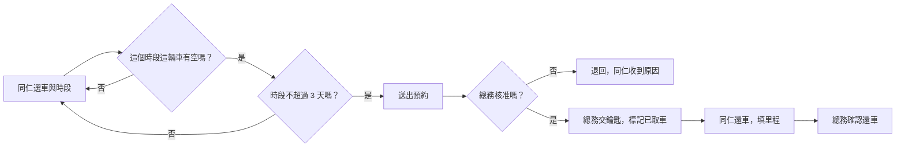

# 2.2 流程

一次用車從預約到還車，同仁和總務各做兩件事。

<table class="lanes">
<tr><th>同仁</th><td>1 送出預約</td><td></td><td></td><td>4 還車、填里程</td><td></td></tr>
<tr><th>總務</th><td></td><td>2 核准或退回</td><td>3 交鑰匙</td><td></td><td>5 確認還車</td></tr>
</table>

